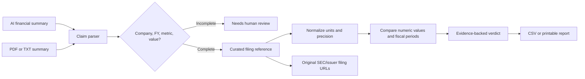

# EvidenceCheck — Financial claim verification

**Live interactive browser demonstration of a working, source-grounded financial claim checker**, built by Redowl Studio.

> **Important:** The GitHub Pages site is a self-contained browser demonstration: it runs its sample verification locally in the browser and does **not** run the Python backend. No documents are sent to a server by this Pages version. The underlying FastAPI app and server-side PDF/TXT import live in this same repository and can be run locally or deployed separately.

## Launch on GitHub Pages

After creating a **public** repository named `evidencecheck` and pushing these files to its `main` branch:

1. Open **Settings → Pages**.
2. Under **Build and deployment**, choose **Deploy from a branch**.
3. Select **main / (root)**, then **Save**.
4. Use the **Visit site** link shown by GitHub once publishing completes.

The repository-root `index.html` and `.nojekyll` are ready; there is no build step.

## What the public demo includes

- Apple-inspired responsive landing, verification workspace, reference library and report viewer
- 45 historical financial facts with issuer/SEC source links for Apple, Microsoft and NVIDIA
- A constructed sample audit with deliberate matching and mismatching claims
- Local batch checking, review outcomes, CSV export and printable report
- Source files, server API and automated tests for the larger Python version

**Scope limitation:** Historical 2023–2025 figures are manually curated. Unsupported claims are flagged for review. This is not a live SEC feed, independent audit, investment advice, or proof of real-world LLM accuracy.

---

# EvidenceCheck · Financial Evidence Verification

**Working portfolio project by Redowl Studio.** An independent check of numeric financial claims generated by AI tools, linked to primary SEC/issuer filings.

> **Historical, offline portfolio demo — not a live filing feed or financial audit.** The 45 source facts are transcribed from FY2025 financial statements for Apple, Microsoft and NVIDIA, spanning FY2023–FY2025. Some *example assertions* are deliberately altered to show issue detection. Reference records are real, example claims are invented, and real-world model performance is not measured.


## What it does

1. An analyst pastes financial claims from an AI-generated summary or imports a text-based PDF/TXT summary.
2. EvidenceCheck parses a company, explicit fiscal period, metric, currency and amount.
3. It cross-checks the reported number with an annual-filing reference table.
4. It classifies each claim as **Verified**, **Mismatch**, **Wrong period**, **Missing evidence**, or **Needs review**.
5. It presents the reported and source amounts side-by-side with a direct link to the original statement.
6. Analysts download a CSV evidence trail or print the verification report to PDF.

**This demonstrates a reliable workflow, not an unrestricted AI fact-checker.** Unsupported or ambiguous claims are routed to review instead of making an unsourced yes/no decision. A matched number does not by itself establish that a larger narrative is accurate.

## Sample output

The supplied demo contains 14 *constructed* statements. Its verified response is:

| Outcome | Sample count | Description |
|---|---:|---|
| Verified | 9 | Consistent with the published financial statement, at stated precision |
| Mismatch | 3 | Incorrect amount for the stated metric and period |
| Wrong period | 1 | Correct amount associated with a different fiscal period |
| Needs review | 1 | Unsupported metric, deliberately included |

Examples:

- `Apple FY2025 revenue was $416.161 billion.` → **Verified**. 2025 net sales of $416,161 million.
- `Microsoft FY2025 net income was $88.136 billion.` → **Wrong period**. That is FY2024; FY2025 net income was $101.832 billion.
- `NVIDIA FY2025 diluted EPS was $2.49 per share.` → **Mismatch**. Published diluted EPS was $2.94.

These figures are traceable to the linked documents below. The negative assertions are intentionally fabricated for testing and should not be presented as mistakes made by a real AI product.

## Run locally

Requires Python 3.10+.

```bash
cd EvidenceCheck
python -m venv .venv
source .venv/bin/activate
# On Windows: .venv\Scripts\activate
pip install -r requirements.txt
uvicorn evidencecheck.server:app --reload
```

Open **http://127.0.0.1:8000** in your browser.

Optional Docker:

```bash
docker build -t evidencecheck .
docker run --rm -p 8000:8000 evidencecheck
```

## API quick start

Interactive API documentation: http://127.0.0.1:8000/docs

| Endpoint | Action |
|---|---|
| `GET /api/health` | Verify service and dataset state |
| `GET /api/library` | Inspect all 45 source facts and provenance |
| `GET /api/demo` | Retrieve intentionally mixed sample and verified report |
| `POST /api/audit` | Audit arbitrary supported claims |
| `POST /api/export.csv` | Export the claim-by-claim audit |
| `POST /api/extract` | Extract text from a PDF/TXT AI summary |
| `POST /api/audit/custom` | Evaluate against a user-supplied, per-request CSV evidence table (not stored) |
| `GET /api/demo/export.csv` | Export sample evidence table |

```bash
curl -X POST http://127.0.0.1:8000/api/audit \
  -H 'Content-Type: application/json' \
  -d '{"text":"Microsoft FY2025 net income was $88.136 billion."}'
```

### Custom source data

`POST /api/audit/custom` accepts JSON with `text` and `reference_csv` fields. The custom CSV must contain `ticker,company,fiscal_year,metric,value,unit,source_url,source_title`. It must have a supported demo ticker (`AAPL`,`MSFT`,`NVDA`), and numerical values must use **USD millions** (or **USD/share** for diluted EPS). Client-provided source figures are treated as client-provided, **not SEC-verified**. They are used only for that request and not persisted.

Example CSV: `samples/custom_reference_example.csv`.

## Test suite and verification

```bash
pip install -e '.[test]'
pytest
PYTHONPATH=. python scripts/benchmark.py
```

Tests cover 45 true-amount assertions, 45 deliberately changed numbers, fiscal-year confusion, rounding precision, missing metadata, unsupported requests, API routes, source links and CSV input.

The 90-case **synthetic** regression controls are seeded directly from the same 45 reference values. Their pass rate must **not** be described as a production accuracy score, third-party validation, benchmark against actual LLM outputs, or user ROI. See `samples/synthetic_regression_results.json`.

## Evidence sources

- [Apple FY2025 Form 10-K, Consolidated Statements of Operations](https://www.sec.gov/Archives/edgar/data/320193/000032019325000079/aapl-20250927.htm)
- [Microsoft FY2025 Form 10-K, Income Statements](https://www.sec.gov/Archives/edgar/data/789019/000095017025100235/msft-20250630.htm)
- [NVIDIA FY2025 Form 10-K, Consolidated Statements of Income](https://www.sec.gov/Archives/edgar/data/1045810/000104581025000023/nvda-20250126.htm)
- [SEC developer documentation](https://www.sec.gov/about/developer-resources)

All baseline values are from USD millions, except diluted earnings per share in USD per share. Fiscal years reflect each issuer's actual fiscal calendar, not calendar-year 2025. All source documents published after FY2025 are deliberately out of scope for reproducibility. The application does not currently pull SEC data in real time.

## Project architecture



Key modules: `evidencecheck/core.py` (parser and evaluator), `evidencecheck/server.py` (FastAPI), `evidencecheck/data` (sourced historic records), `evidencecheck/static` (interactive dashboard), `tests` (regression tests).

## Known limitations / roadmap

- Historical, human-transcribed FY2025 comparison dataset; no live SEC EDGAR CompanyFacts ingestion, accession-version pinning or automatic updating yet.
- Only three issuers, five metrics and explicitly labeled fiscal years. A PDF can supply **claim text**, not independent trusted ground truth. Image-only PDFs need OCR (not included).
- Supports USD million/billion/thousand units and per-share EPS. Does not validate qualitative financial analysis, non-GAAP disclosures, ratios, segment breakdowns, other currencies or ambiguous calendar periods.
- Rounding tolerance is based on displayed precision; matching is a *numerical consistency* check, not audit assurance.
- No logins, organization isolation, encryption-at-rest, SOC 2 compliance, production audit trail or legal/accounting review. **Do not upload confidential financial data to an untrusted host.** Run locally with publicly available or approved datasets.
- For a paid production pilot: add automatic SEC/XBRL ingestion, source-table extraction and context-specific citations, configurable company/metric mapping, authorization, hardened data storage, exception review queue, performance evaluation on unseen documents and deployment security review.

## Client design-partner offer

The demo is already a working proof of concept. A **$100 introductory validation engagement**, if accepted, can be narrowly scoped to ten approved claims, three public documents, a script and the discrepancy report. Custom onboarding and production integration are separate engagements. See `docs/PILOT_SCOPE.md`.

© 2026 Redowl Studio. Built for demonstration and technical evaluation. No affiliation with Apple, Microsoft, NVIDIA or the SEC. Not financial advice.


## Refreshed user experience (Apple-inspired, original design)

The interface now uses a light, restrained visual language with large editorial typography, generous whitespace, soft gradients, floating illustrative claim card, translucent top navigation, native-feeling pill controls and clear source/issue/review signals. It is an original EvidenceCheck visual system, not an Apple product or replica.

UX improvements: simplified horizontal navigation; single primary verification action; accessible states and visible error messages; mobile-first responsive layout; keyboard shortcut (Command/Ctrl + Enter); stale reports automatically cleared after editing an input; export controls unavailable until fresh results exist. No external fonts, tracking scripts, images or hosted CSS are needed. The static HTML preview works offline and supports its own deterministic verification engine; importing PDF/TXT requires running the Python API version.
